

  <picture>
    <source media="(prefers-color-scheme: dark)"  srcset="assets/hero-dark.svg">
    <source media="(prefers-color-scheme: light)" srcset="assets/hero-light.svg">
    
  </picture>

<a href="https://github.com/solacode-SC">
  <picture>
    <source media="(prefers-color-scheme: dark)"  srcset="assets/btn-github-dark.svg">
    <source media="(prefers-color-scheme: light)" srcset="assets/btn-github-light.svg">
    
  </picture>
</a> &nbsp; <a href="https://www.linkedin.com/in/solayman-elmouden/">
  <picture>
    <source media="(prefers-color-scheme: dark)"  srcset="assets/btn-linkedin-dark.svg">
    <source media="(prefers-color-scheme: light)" srcset="assets/btn-linkedin-light.svg">
    
  </picture>
</a> &nbsp; <a href="https://solaymanbuilds.com">
  <picture>
    <source media="(prefers-color-scheme: dark)"  srcset="assets/btn-portfolio-dark.svg">
    <source media="(prefers-color-scheme: light)" srcset="assets/btn-portfolio-light.svg">
    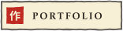
  </picture>
</a>

  <picture>
    <source media="(prefers-color-scheme: dark)"  srcset="assets/about-dark.svg">
    <source media="(prefers-color-scheme: light)" srcset="assets/about-light.svg">
    
  </picture>

  <picture>
    <source media="(prefers-color-scheme: dark)"  srcset="assets/skills-dark.svg">
    <source media="(prefers-color-scheme: light)" srcset="assets/skills-light.svg">
    
  </picture>

  <picture>
    <source media="(prefers-color-scheme: dark)"  srcset="assets/projects-title-dark.svg">
    <source media="(prefers-color-scheme: light)" srcset="assets/projects-title-light.svg">
    
  </picture>

<a href="https://leetresume.solaymanbuilds.com">
  <picture>
    <source media="(prefers-color-scheme: dark)"  srcset="assets/card-leetresume-dark.svg">
    <source media="(prefers-color-scheme: light)" srcset="assets/card-leetresume-light.svg">
    
  </picture>
</a>
<a href="https://fastdownloading.solaymanbuilds.com">
  <picture>
    <source media="(prefers-color-scheme: dark)"  srcset="assets/card-fastdl-dark.svg">
    <source media="(prefers-color-scheme: light)" srcset="assets/card-fastdl-light.svg">
    
  </picture>
</a>
<a href="https://lazyequation.solaymanbuilds.com">
  <picture>
    <source media="(prefers-color-scheme: dark)"  srcset="assets/card-lazy-equation-dark.svg">
    <source media="(prefers-color-scheme: light)" srcset="assets/card-lazy-equation-light.svg">
    
  </picture>
</a>

<a href="https://xstudio.solaymanbuilds.com">
  <picture>
    <source media="(prefers-color-scheme: dark)"  srcset="assets/card-xstudio-dark.svg">
    <source media="(prefers-color-scheme: light)" srcset="assets/card-xstudio-light.svg">
    
  </picture>
</a>
<a href="https://mdconverter.solaymanbuilds.com">
  <picture>
    <source media="(prefers-color-scheme: dark)"  srcset="assets/card-md-converter-dark.svg">
    <source media="(prefers-color-scheme: light)" srcset="assets/card-md-converter-light.svg">
    
  </picture>
</a>
<a href="https://chemify-pi.vercel.app/">
  <picture>
    <source media="(prefers-color-scheme: dark)"  srcset="assets/card-chemify-dark.svg">
    <source media="(prefers-color-scheme: light)" srcset="assets/card-chemify-light.svg">
    
  </picture>
</a>

  <picture>
    <source media="(prefers-color-scheme: dark)"  srcset="assets/footer-dark.svg">
    <source media="(prefers-color-scheme: light)" srcset="assets/footer-light.svg">
    
  </picture>

<a href="https://solaymanbuilds.com">solaymanbuilds.com</a> &nbsp;·&nbsp; <a href="https://www.linkedin.com/in/solayman-elmouden/">LinkedIn</a> &nbsp;·&nbsp; <a href="https://github.com/solacode-SC">GitHub</a>

