

<picture><source media="(prefers-color-scheme: dark)" srcset="./assets/header-dark.svg"><source media="(prefers-color-scheme: light)" srcset="./assets/header-light.svg">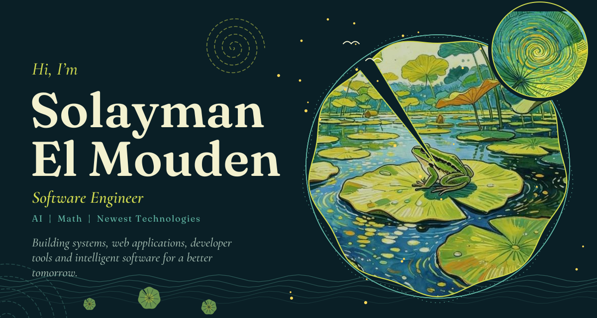</picture>

<picture><source media="(prefers-color-scheme: dark)" srcset="./assets/divider-dark.svg"><source media="(prefers-color-scheme: light)" srcset="./assets/divider-light.svg">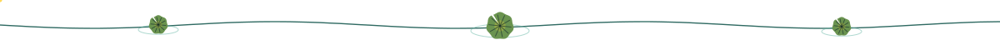</picture>

<picture><source media="(prefers-color-scheme: dark)" srcset="./assets/about-dark.svg"><source media="(prefers-color-scheme: light)" srcset="./assets/about-light.svg"></picture>

I’m Solayman El Mouden, a software engineer focused on systems, web technologies, artificial intelligence and mathematics.

I enjoy understanding how things work underneath the abstraction and turning that knowledge into useful software.

<picture><source media="(prefers-color-scheme: dark)" srcset="./assets/approach-dark.svg"><source media="(prefers-color-scheme: light)" srcset="./assets/approach-light.svg">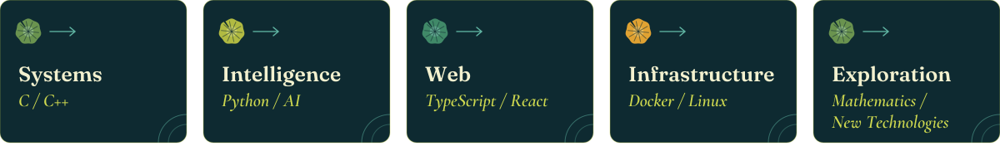</picture>

<picture><source media="(prefers-color-scheme: dark)" srcset="./assets/divider-dark.svg"><source media="(prefers-color-scheme: light)" srcset="./assets/divider-light.svg"></picture>

<picture><source media="(prefers-color-scheme: dark)" srcset="./assets/skills-dark.svg"><source media="(prefers-color-scheme: light)" srcset="./assets/skills-light.svg"></picture>

<picture><source media="(prefers-color-scheme: dark)" srcset="./assets/skills-grid-dark.svg"><source media="(prefers-color-scheme: light)" srcset="./assets/skills-grid-light.svg">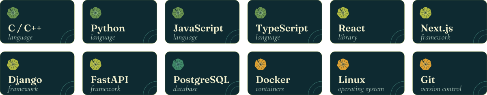</picture>

<picture><source media="(prefers-color-scheme: dark)" srcset="./assets/divider-dark.svg"><source media="(prefers-color-scheme: light)" srcset="./assets/divider-light.svg"></picture>

<picture><source media="(prefers-color-scheme: dark)" srcset="./assets/projects-title-dark.svg"><source media="(prefers-color-scheme: light)" srcset="./assets/projects-title-light.svg"></picture>

<table>
<tr>
<td width="50%"><a href="https://leetresume.solaymanbuilds.com"><picture><source media="(prefers-color-scheme: dark)" srcset="./assets/card-leetresume-dark.svg"><source media="(prefers-color-scheme: light)" srcset="./assets/card-leetresume-light.svg"></picture></a></td>
<td width="50%"><a href="https://fastdownloading.solaymanbuilds.com"><picture><source media="(prefers-color-scheme: dark)" srcset="./assets/card-fastdl-dark.svg"><source media="(prefers-color-scheme: light)" srcset="./assets/card-fastdl-light.svg"></picture></a></td>
</tr>
<tr>
<td width="50%"><a href="https://lazyequation.solaymanbuilds.com"><picture><source media="(prefers-color-scheme: dark)" srcset="./assets/card-lazy-equation-dark.svg"><source media="(prefers-color-scheme: light)" srcset="./assets/card-lazy-equation-light.svg"></picture></a></td>
<td width="50%"><a href="https://xstudio.solaymanbuilds.com"><picture><source media="(prefers-color-scheme: dark)" srcset="./assets/card-xstudio-dark.svg"><source media="(prefers-color-scheme: light)" srcset="./assets/card-xstudio-light.svg"></picture></a></td>
</tr>
<tr>
<td width="50%"><a href="https://mdconverter.solaymanbuilds.com"><picture><source media="(prefers-color-scheme: dark)" srcset="./assets/card-md-converter-dark.svg"><source media="(prefers-color-scheme: light)" srcset="./assets/card-md-converter-light.svg"></picture></a></td>
<td width="50%"><a href="https://chemify-pi.vercel.app/"><picture><source media="(prefers-color-scheme: dark)" srcset="./assets/card-chemify-dark.svg"><source media="(prefers-color-scheme: light)" srcset="./assets/card-chemify-light.svg"></picture></a></td>
</tr>
</table>

<picture><source media="(prefers-color-scheme: dark)" srcset="./assets/footer-dark.svg"><source media="(prefers-color-scheme: light)" srcset="./assets/footer-light.svg"></picture>

[solaymanbuilds.com](https://solaymanbuilds.com) · [LinkedIn](https://www.linkedin.com/in/solayman-elmouden/) · [GitHub](https://github.com/solacode-SC)

