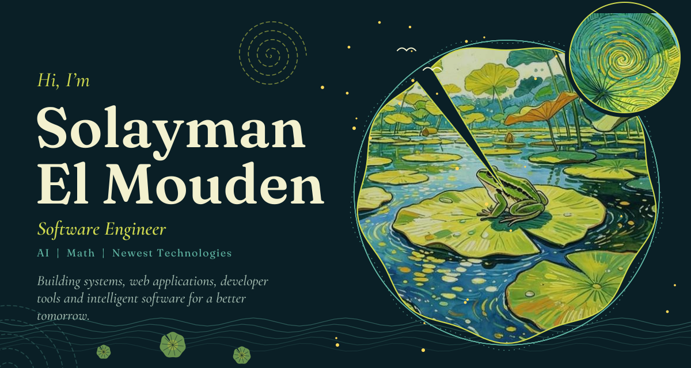
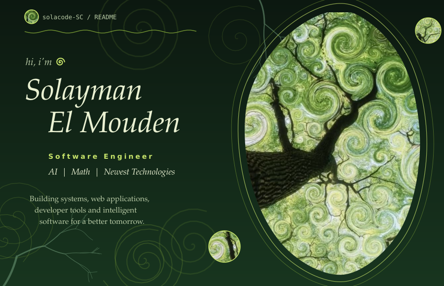

# Solayman El Mouden — Rotating Art Profile Gallery

**8 Bespoke Vector Themes · 12-Hour Automated Rotation · 6 Live Deployed Products**

---

## Live Deployed Projects Showcase

All **8 profile templates** highlight the same 6 live production applications powered by a single central manifest ([`profile-data.json`](./profile-data.json)):

| # | Project | Category | Summary | Stack | Live Link |
| :-: | :--- | :--- | :--- | :--- | :--- |
| **01** | **LeetResume** | `AI SaaS` | AI-powered LaTeX resume builder with isolated XeLaTeX PDF generation and DeepSeek AI refinement. | `Next.js` `PostgreSQL` `XeLaTeX` `DeepSeek` | [leetresume.solaymanbuilds.com ↗](https://leetresume.solaymanbuilds.com) |
| **02** | **FastDL** | `Live Platform` | Stateless high-speed social media video downloader powered by FastAPI and yt-dlp with zero server storage or buffering. | `Next.js` `FastAPI` `yt-dlp` `Docker` | [fastdownloading.solaymanbuilds.com ↗](https://fastdownloading.solaymanbuilds.com) |
| **03** | **Lazy Equation** | `Interactive` | Interactive digital museum and real-time canvas sandbox for exploring and visualizing math and physics formulas. | `React` `TypeScript` `Fastify` `Canvas` | [lazyequation.solaymanbuilds.com ↗](https://lazyequation.solaymanbuilds.com) |
| **04** | **Xstudio** | `PDF Toolkit` | Local-first, privacy-focused PDF toolkit featuring 9 utilities (split, merge, compress, rotate, PDF↔images, PDF-to-DOCX) with zero data retention. | `Next.js` `FastAPI` `PyMuPDF` `Docker` | [xstudio.solaymanbuilds.com ↗](https://xstudio.solaymanbuilds.com) |
| **05** | **MD Converter** | `AI Utility` | Stateless document-to-Markdown converter turning PDF, DOCX, and PPTX files into clean Markdown for AI workflows. | `Next.js` `FastAPI` `Tailwind` `Docker` | [mdconverter.solaymanbuilds.com ↗](https://mdconverter.solaymanbuilds.com) |
| **06** | **Chemify** | `Science Lab` | Zero-dependency interactive chemistry platform with a periodic table explorer, stoichiometry reaction studio, and calculators. | `HTML` `CSS` `JavaScript` | [chemify-pi.vercel.app ↗](https://chemify-pi.vercel.app/) |

---

## 8-Theme Visual Gallery (12 Hours Each · 96-Hour Full Cycle)

Every **12 hours** (`0 */12 * * *`), GitHub Actions automatically advances to the next artistic theme in sequential order. Every theme supports GitHub's native `(prefers-color-scheme: dark)` and `(prefers-color-scheme: light)` modes.

<table>
  <tr>
    <td width="50%" valign="top">
      <h3>01 · Lily Pond (Monet Impressionism)</h3>
      
<code>solacode-lilypond</code> · 12h slot · 2×3 bespoke vector-overlay project medallions, ripples &amp; fireflies.

      <a href="./other-profile/solacode-lilypond/README.md">
        <picture>
          <source media="(prefers-color-scheme: dark)" srcset="./other-profile/solacode-lilypond/assets/header-dark.svg">
          <source media="(prefers-color-scheme: light)" srcset="./other-profile/solacode-lilypond/assets/header-light.svg">
          
        </picture>
      </a>
    </td>
    <td width="50%" valign="top">
      <h3>02 · Autumn Garden</h3>
      
<code>profile-readme-garden</code> · 12h slot · Falling autumn leaves, lantern flicker, and 3×2 framed live project cards.

      <a href="./other-profile/profile-readme-garden/README.md">
        <picture>
          <source media="(prefers-color-scheme: dark)" srcset="./other-profile/profile-readme-garden/assets/hero-dark.svg">
          <source media="(prefers-color-scheme: light)" srcset="./other-profile/profile-readme-garden/assets/hero-light.svg">
          
        </picture>
      </a>
    </td>
  </tr>
  <tr>
    <td width="50%" valign="top">
      <h3>03 · Japanese Ink Scroll</h3>
      
<code>profile-readme-inkscroll</code> · 12h slot · Hand-painted hanging scroll, vermilion seals &amp; 3×2 album-leaf cards.

      <a href="./other-profile/profile-readme-inkscroll/README.md">
        <picture>
          <source media="(prefers-color-scheme: dark)" srcset="./other-profile/profile-readme-inkscroll/assets/hero-dark.svg">
          <source media="(prefers-color-scheme: light)" srcset="./other-profile/profile-readme-inkscroll/assets/hero-light.svg">
          
        </picture>
      </a>
    </td>
    <td width="50%" valign="top">
      <h3>04 · Flow Field &amp; Swirl</h3>
      
<code>profile-readme-swirl</code> · 12h slot · Multi-vortex streamlines, Archimedean spirals &amp; 6 algorithmic project motifs.

      <a href="./other-profile/profile-readme-swirl/README.md">
        <picture>
          <source media="(prefers-color-scheme: dark)" srcset="./other-profile/profile-readme-swirl/assets/hero-dark.svg">
          <source media="(prefers-color-scheme: light)" srcset="./other-profile/profile-readme-swirl/assets/hero-light.svg">
          
        </picture>
      </a>
    </td>
  </tr>
  <tr>
    <td width="50%" valign="top">
      <h3>05 · Kintsugi Lotus Pond</h3>
      
<code>solacode-lotus-readme</code> · 12h slot · Kintsugi gold seams, swimming koi &amp; 3×2 shimmering gold-framed cards.

      <a href="./other-profile/solacode-lotus-readme/README.md">
        <picture>
          <source media="(prefers-color-scheme: dark)" srcset="./other-profile/solacode-lotus-readme/assets/hero-dark.svg">
          <source media="(prefers-color-scheme: light)" srcset="./other-profile/solacode-lotus-readme/assets/hero-light.svg">
          
        </picture>
      </a>
    </td>
    <td width="50%" valign="top">
      <h3>06 · Andalusian Heritage</h3>
      
<code>solacode-readme-andalus</code> · 12h slot · Alhambra horseshoe arches, zellige stars &amp; 3×2 merlon-crowned cards.

      <a href="./other-profile/solacode-readme-andalus/README.md">
        <picture>
          <source media="(prefers-color-scheme: dark)" srcset="./other-profile/solacode-readme-andalus/assets/hero-dark.svg">
          <source media="(prefers-color-scheme: light)" srcset="./other-profile/solacode-readme-andalus/assets/hero-light.svg">
          
        </picture>
      </a>
    </td>
  </tr>
  <tr>
    <td width="50%" valign="top">
      <h3>07 · Canopy Spiral</h3>
      
<code>solacode-readme-canopy</code> · 12h slot · Organic canopy spirals, golden phyllotaxis &amp; 3×2 botanical medallions.

      <a href="./other-profile/solacode-readme-canopy/README.md">
        <picture>
          <source media="(prefers-color-scheme: dark)" srcset="./other-profile/solacode-readme-canopy/assets/hero-dark.svg">
          <source media="(prefers-color-scheme: light)" srcset="./other-profile/solacode-readme-canopy/assets/hero-light.svg">
          
        </picture>
      </a>
    </td>
    <td width="50%" valign="top">
      <h3>08 · Topographic Tree</h3>
      
<code>solayman-tree-readme</code> · 12h slot · Algorithmic topographic contours, growth rings &amp; 2×3 clickable live cards.

      <a href="./other-profile/solayman-tree-readme/README.md">
        <picture>
          <source media="(prefers-color-scheme: dark)" srcset="./other-profile/solayman-tree-readme/assets/header-dark.svg">
          <source media="(prefers-color-scheme: light)" srcset="./other-profile/solayman-tree-readme/assets/header-light.svg">
          
        </picture>
      </a>
    </td>
  </tr>
</table>

---

## Rotation Engine & CLI (`rotate.py`)

Zero-dependency Python 3 engine synchronized with [`.github/workflows/rotate-readme.yml`](./.github/workflows/rotate-readme.yml):

| Command | Action |
| :--- | :--- |
| `python rotate.py --status` | Show active theme, 12-hour schedule, next theme, and shared profile summary |
| `python rotate.py --next` | Advance to the next theme in the 8-theme cycle |
| `python rotate.py --theme <id>` | Activate a specific theme immediately (e.g., `--theme solacode-readme-andalus`) |
| `python rotate.py --list` | List all 8 themes with asset health and descriptions |
| `python rotate.py --verify` | Verify all themes, dark/light SVG integrity, and absence of unreferenced cards |
| `python rotate.py --sync` | Sync all templates and GitHub Actions cron with `profile-data.json` |
| `python rotate.py --interval 12` | Set rotation cadence to every 12 hours (`0 */12 * * *`) |

### Automated GitHub Actions Schedule

1. **12-Hour Cron (`0 */12 * * *`)** — Automatically rotates through all 8 themes sequentially so each template is featured for **12 hours**.
2. **Push Sync** — Any edit to `profile-data.json` automatically syncs templates.
3. **Manual Dispatch** — Trigger any specific theme on demand from the GitHub Actions tab.
