

<!-- HERO BANNER -->
<picture>
  <source media="(prefers-color-scheme: dark)" srcset="assets/header-dark.svg">
  <source media="(prefers-color-scheme: light)" srcset="assets/header-light.svg">
  
</picture>

 

<!-- CONNECT BUTTONS -->

  
  &nbsp;
  
  &nbsp;
  

<!-- SECTION DIVIDER -->
<picture>
  <source media="(prefers-color-scheme: dark)" srcset="assets/divider-dark.svg">
  <source media="(prefers-color-scheme: light)" srcset="assets/divider-light.svg">
  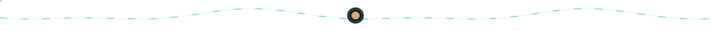
</picture>

 

<!-- FOUR PILLARS / ABOUT -->
<picture>
  <source media="(prefers-color-scheme: dark)" srcset="assets/about-dark.svg">
  <source media="(prefers-color-scheme: light)" srcset="assets/about-light.svg">
  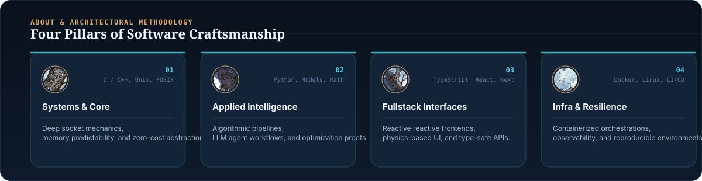
</picture>

  

<!-- GROWTH RINGS / SKILLS MATRIX -->
<picture>
  <source media="(prefers-color-scheme: dark)" srcset="assets/skills-dark.svg">
  <source media="(prefers-color-scheme: light)" srcset="assets/skills-light.svg">
  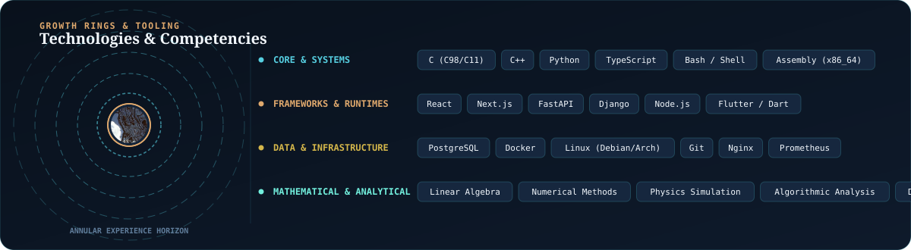
</picture>

  

<!-- SECTION DIVIDER -->
<picture>
  <source media="(prefers-color-scheme: dark)" srcset="assets/divider-dark.svg">
  <source media="(prefers-color-scheme: light)" srcset="assets/divider-light.svg">
  
</picture>

 

<!-- SELECTED LIVE PROJECTS HEADER -->
<picture>
  <source media="(prefers-color-scheme: dark)" srcset="assets/projects-title-dark.svg">
  <source media="(prefers-color-scheme: light)" srcset="assets/projects-title-light.svg">
  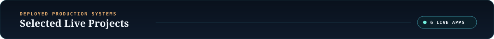
</picture>

<table>
<tr>
  <td width="50%"><a href="https://leetresume.solaymanbuilds.com"><picture><source media="(prefers-color-scheme: dark)" srcset="assets/card-leetresume-dark.svg"><source media="(prefers-color-scheme: light)" srcset="assets/card-leetresume-light.svg">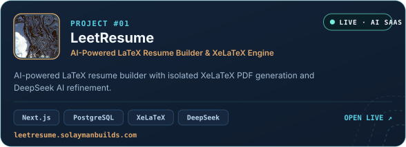</picture></a></td>
  <td width="50%"><a href="https://fastdownloading.solaymanbuilds.com"><picture><source media="(prefers-color-scheme: dark)" srcset="assets/card-fastdl-dark.svg"><source media="(prefers-color-scheme: light)" srcset="assets/card-fastdl-light.svg">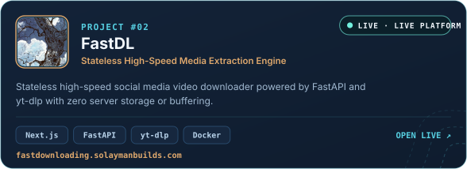</picture></a></td>
</tr>
<tr>
  <td width="50%"><a href="https://lazyequation.solaymanbuilds.com"><picture><source media="(prefers-color-scheme: dark)" srcset="assets/card-lazy-equation-dark.svg"><source media="(prefers-color-scheme: light)" srcset="assets/card-lazy-equation-light.svg">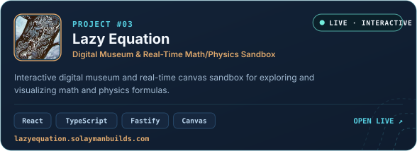</picture></a></td>
  <td width="50%"><a href="https://xstudio.solaymanbuilds.com"><picture><source media="(prefers-color-scheme: dark)" srcset="assets/card-xstudio-dark.svg"><source media="(prefers-color-scheme: light)" srcset="assets/card-xstudio-light.svg">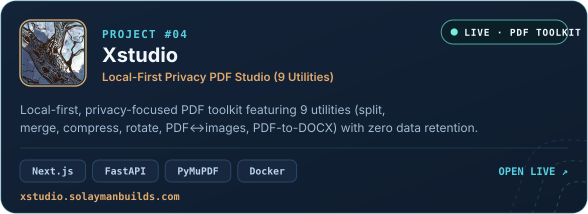</picture></a></td>
</tr>
<tr>
  <td width="50%"><a href="https://mdconverter.solaymanbuilds.com"><picture><source media="(prefers-color-scheme: dark)" srcset="assets/card-md-converter-dark.svg"><source media="(prefers-color-scheme: light)" srcset="assets/card-md-converter-light.svg">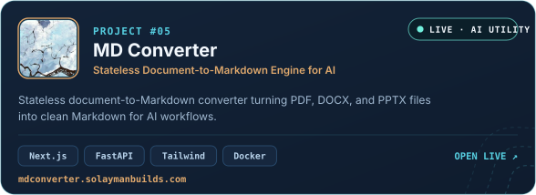</picture></a></td>
  <td width="50%"><a href="https://chemify-pi.vercel.app/"><picture><source media="(prefers-color-scheme: dark)" srcset="assets/card-chemify-dark.svg"><source media="(prefers-color-scheme: light)" srcset="assets/card-chemify-light.svg">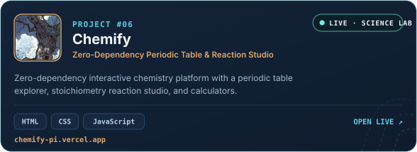</picture></a></td>
</tr>
</table>

<!-- QUICK LIVE LAUNCH BAR -->

  <a href="https://leetresume.solaymanbuilds.com"><b>[ 01 · LeetResume ↗ ]</b></a> &nbsp;•&nbsp;
  <a href="https://fastdownloading.solaymanbuilds.com"><b>[ 02 · FastDL ↗ ]</b></a> &nbsp;•&nbsp;
  <a href="https://lazyequation.solaymanbuilds.com"><b>[ 03 · Lazy Equation ↗ ]</b></a> &nbsp;•&nbsp;
  <a href="https://xstudio.solaymanbuilds.com"><b>[ 04 · Xstudio ↗ ]</b></a> &nbsp;•&nbsp;
  <a href="https://mdconverter.solaymanbuilds.com"><b>[ 05 · MD Converter ↗ ]</b></a> &nbsp;•&nbsp;
  <a href="https://chemify-pi.vercel.app/"><b>[ 06 · Chemify ↗ ]</b></a>

 

<!-- FOOTER -->
<picture>
  <source media="(prefers-color-scheme: dark)" srcset="assets/footer-dark.svg">
  <source media="(prefers-color-scheme: light)" srcset="assets/footer-light.svg">
  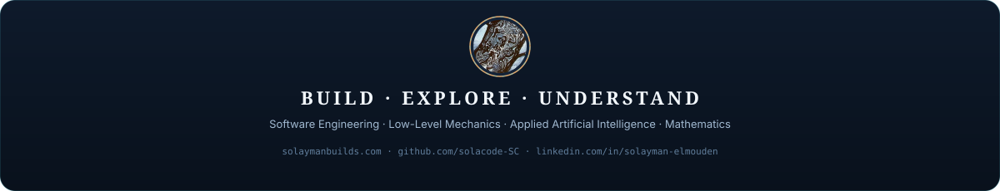
</picture>

 

Designed with organic topographic algorithms · <a href="https://solaymanbuilds.com">solaymanbuilds.com</a> · <a href="https://www.linkedin.com/in/solayman-elmouden/">LinkedIn</a>

